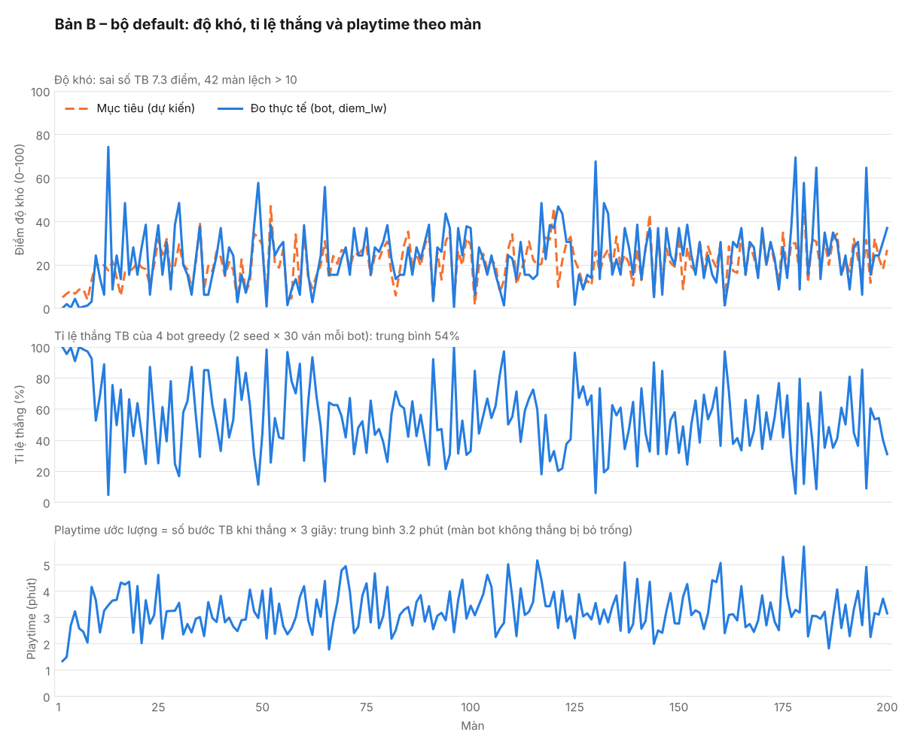
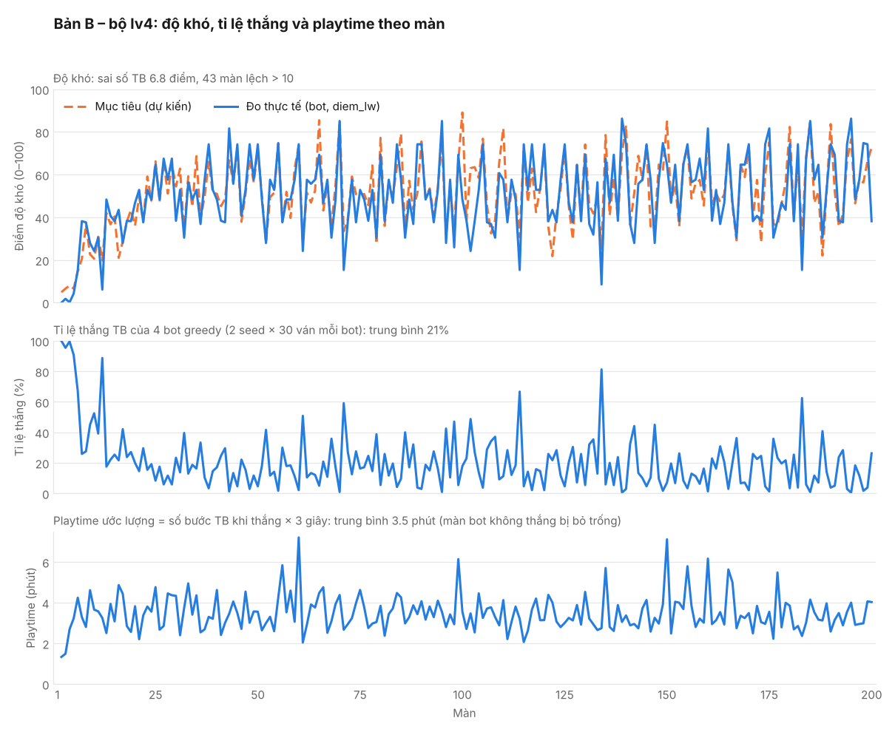

# Báo cáo Sweet Rope: bản A và bản B (28/11/2026)

Báo cáo chung duy nhất cho toàn bộ level đã sinh. Bản A: 200 màn, một bộ cho mọi người chơi, mục tiêu theo đường độ khó riêng. Bản B: 5 bộ (`default`, `lv2`–`lv5`) × 199 màn (màn 1 dùng level hướng dẫn), mục tiêu bằng `summaryScore` của Sort Streak cùng màn cùng bộ; các bộ có cùng điểm ở cùng màn dùng chung một level (680 level).

**Cách đo:** điểm "thực tế" là điểm bot (`tools/score.py`, cột `diem_lw`), sai số khoảng ±9 mỗi level; màn trên 70 điểm bị chấm thấp khoảng 18.

## 0. Tóm tắt

- Mọi level theo luật Sort Streak: không dây nào đầy sẵn đúng màu chậu (lúc mở và khi vào từ hàng chờ), tối đa 3 hoa thường cùng màu liền nhau (hoa ẩn không tính).
- Tất cả level đúng sức chứa của Sort Streak cùng màn cùng bộ (bản A theo bộ `default`), ≤ 14 cốc, ≤ 7 dây, giải được (solver Godot hoặc bot thắng).
- Sinh lại 875 level vi phạm luật Sort Streak (199 màn A, 676 nhóm B); sai số TB của nhóm này 7.2, 192 mục lệch > 10.
- Trùng lặp với 21 325 level có sẵn trong project: 0 level giống > 80% (giống nhất 0.667).
- Luật LevelDesigner (`validateLevel`, bản port C#): 1195 level, 0 lỗi, 0 cảnh báo.
- Gói Unity `sweetrope.levelpack/1`: `levels/package/SweetRope_A.zip`, `levels/package/SweetRope_B.zip`.

## 1. Độ khó dự kiến (mục tiêu) và thực tế (đo bằng bot, `diem_lw`)

| Bộ | Số màn | Mục tiêu TB | Đo TB | Lệch TB (có dấu) | Sai số TB | ≤ 5 | 5–10 | > 10 |
|---|---|---|---|---|---|---|---|---|
| A | 200 | 21.2 | 23.7 | +2.5 | 6.8 | 119 | 47 | 34 |
| default | 199 | 21.1 | 23.5 | +2.4 | 7.3 | 109 | 48 | 42 |
| lv2 | 199 | 26.7 | 28.3 | +1.6 | 7.0 | 99 | 55 | 45 |
| lv3 | 199 | 39.9 | 40.7 | +0.8 | 6.8 | 99 | 61 | 39 |
| lv4 | 199 | 51.2 | 50.4 | -0.7 | 6.8 | 103 | 53 | 43 |
| lv5 | 199 | 59.6 | 56.6 | -3.0 | 7.6 | 107 | 38 | 54 |

Theo chặng 25 màn (mục tiêu → đo):

| Màn | A | default | lv2 | lv3 | lv4 | lv5 |
|---|---|---|---|---|---|---|
| 1–25 | 11.1 → 19.8 | 14.6 → 17.4 | 18.6 → 20.2 | 25.7 → 29.1 | 30.8 → 31.8 | 35.5 → 34.5 |
| 26–50 | 19.9 → 23.3 | 20.6 → 22.5 | 27.9 → 30.3 | 44.2 → 43.1 | 55.3 → 55.1 | 62.6 → 61.8 |
| 51–75 | 20.2 → 20.4 | 21.0 → 21.4 | 27.2 → 27.2 | 40.3 → 38.7 | 51.7 → 50.5 | 61.6 → 61.0 |
| 76–100 | 21.0 → 26.3 | 22.6 → 25.6 | 25.5 → 27.0 | 42.1 → 40.2 | 54.4 → 51.3 | 62.4 → 54.1 |
| 101–125 | 22.3 → 24.9 | 22.2 → 22.8 | 29.4 → 31.0 | 41.9 → 43.2 | 52.4 → 49.7 | 61.0 → 59.4 |
| 126–150 | 23.0 → 23.1 | 21.3 → 25.7 | 27.5 → 33.6 | 41.5 → 45.4 | 54.4 → 52.3 | 62.5 → 59.4 |
| 151–175 | 25.4 → 26.2 | 22.0 → 22.9 | 28.5 → 30.4 | 42.7 → 44.3 | 54.4 → 56.3 | 65.9 → 61.2 |
| 176–200 | 26.4 → 25.8 | 24.6 → 29.7 | 28.5 → 26.3 | 40.3 → 41.2 | 55.0 → 55.7 | 64.6 → 60.6 |

## 2. Bot: tỉ lệ thắng và số bước khi thắng (playtime)

Bốn cấu hình bot greedy có nhiễu, mỗi cấu hình 2 seed × 30 ván. Playtime ước lượng = số bước TB × 3 giây/bước (giả định).

| Bộ | Thắng eps0.3 | Thắng eps0.45 | Thắng eps0.6 | Thắng softmaxT4 | Thắng TB | Số bước TB | Playtime ước lượng |
|---|---|---|---|---|---|---|---|
| A | 56% | 53% | 49% | 54% | 53% | 64 | 3.2 phút |
| default | 58% | 55% | 49% | 54% | 54% | 65 | 3.2 phút |
| lv2 | 50% | 47% | 42% | 47% | 46% | 66 | 3.3 phút |
| lv3 | 31% | 30% | 28% | 29% | 29% | 71 | 3.5 phút |
| lv4 | 21% | 20% | 20% | 21% | 21% | 70 | 3.5 phút |
| lv5 | 16% | 16% | 16% | 16% | 16% | 70 | 3.5 phút |

Theo chặng (thắng TB % / số bước TB):

| Màn | A | default | lv2 | lv3 | lv4 | lv5 |
|---|---|---|---|---|---|---|
| 1–25 | 63% / 61 | 67% / 63 | 60% / 64 | 47% / 64 | 42% / 67 | 40% / 64 |
| 26–50 | 54% / 62 | 55% / 60 | 43% / 65 | 24% / 71 | 15% / 70 | 11% / 69 |
| 51–75 | 58% / 65 | 57% / 66 | 49% / 65 | 31% / 78 | 19% / 74 | 12% / 75 |
| 76–100 | 50% / 64 | 49% / 65 | 47% / 64 | 29% / 73 | 19% / 71 | 16% / 71 |
| 101–125 | 51% / 64 | 55% / 70 | 41% / 69 | 27% / 70 | 20% / 66 | 14% / 66 |
| 126–150 | 54% / 62 | 51% / 63 | 40% / 70 | 24% / 74 | 19% / 70 | 12% / 73 |
| 151–175 | 48% / 66 | 53% / 67 | 43% / 64 | 25% / 71 | 14% / 72 | 11% / 71 |
| 176–200 | 48% / 64 | 46% / 65 | 48% / 65 | 29% / 66 | 16% / 67 | 12% / 68 |

## 3. Bố cục: level mới so với Sort Streak cùng màn, cùng bộ (TB mới / TB Sort Streak, % màn khớp đúng)

| Bộ | Sức chứa | Số dây đầu | Số cốc | Số màu | Hoa ẩn | Dây khóa | Độ dài hàng chờ |
|---|---|---|---|---|---|---|---|
| A | 5.0 / 5.0 (100%) | 6.4 / 6.4 (98%) | 11.1 / 11.1 (99%) | 8.8 / 8.8 (99%) | 1.9 / 1.9 (44%) | 0.1 / 0.5 (76%) | 10.1 / 10.1 (99%) |
| default | 5.0 / 5.0 (100%) | 6.4 / 6.4 (98%) | 11.1 / 11.1 (99%) | 8.8 / 8.8 (99%) | 1.9 / 1.9 (50%) | 0.1 / 0.5 (73%) | 10.1 / 10.1 (99%) |
| lv2 | 5.0 / 5.0 (100%) | 6.4 / 6.4 (99%) | 11.1 / 11.1 (99%) | 8.9 / 8.8 (99%) | 2.1 / 2.0 (47%) | 0.1 / 0.5 (72%) | 10.1 / 10.1 (99%) |
| lv3 | 5.0 / 5.0 (100%) | 6.4 / 6.4 (99%) | 11.3 / 11.3 (99%) | 8.9 / 8.9 (99%) | 2.7 / 2.6 (46%) | 0.1 / 0.5 (72%) | 10.3 / 10.3 (99%) |
| lv4 | 5.0 / 5.0 (100%) | 6.4 / 6.4 (99%) | 11.4 / 11.3 (99%) | 8.9 / 8.9 (99%) | 2.8 / 2.6 (37%) | 0.1 / 0.6 (71%) | 10.4 / 10.3 (99%) |
| lv5 | 5.0 / 5.0 (100%) | 6.4 / 6.4 (99%) | 11.5 / 11.5 (99%) | 8.9 / 8.9 (99%) | 2.8 / 2.7 (40%) | 0.1 / 0.6 (68%) | 10.5 / 10.5 (99%) |

## 4. Bonus

- **A**: 19 màn bonus cố định, 19 đạt luật (có màu chỉ 1 chậu). Ngoài vị trí bonus còn **181 màn** cũng đủ điều kiện bonus.
- **default**: 19 màn bonus cố định, 19 đạt luật (có màu chỉ 1 chậu). Ngoài vị trí bonus còn **180 màn** cũng đủ điều kiện bonus.
- **lv2**: 19 màn bonus cố định, 19 đạt luật (có màu chỉ 1 chậu). Ngoài vị trí bonus còn **180 màn** cũng đủ điều kiện bonus.
- **lv3**: 19 màn bonus cố định, 19 đạt luật (có màu chỉ 1 chậu). Ngoài vị trí bonus còn **180 màn** cũng đủ điều kiện bonus.
- **lv4**: 19 màn bonus cố định, 19 đạt luật (có màu chỉ 1 chậu). Ngoài vị trí bonus còn **180 màn** cũng đủ điều kiện bonus.
- **lv5**: 19 màn bonus cố định, 19 đạt luật (có màu chỉ 1 chậu). Ngoài vị trí bonus còn **180 màn** cũng đủ điều kiện bonus.

Chi tiết màn ngoài vị trí bonus nhưng đủ điều kiện (màu chỉ có 1 chậu): xem cột `mau_1_chau` trong file chi tiết.

## 5. Tag đặc biệt

| Bộ | Hướng dẫn | Hard | Bonus | Challenge | Endless |
|---|---|---|---|---|---|
| A | 1 | 40 | 19 | 19 | 18 |
| default | 0 | 40 | 19 | 19 | 18 |
| lv2 | 0 | 40 | 19 | 19 | 18 |
| lv3 | 0 | 40 | 19 | 19 | 18 |
| lv4 | 0 | 40 | 19 | 19 | 18 |
| lv5 | 0 | 40 | 19 | 19 | 18 |

## 6. Kiểm trùng lặp

So mỗi level mới với mọi level có sẵn: GD_Lazy (branch main), LevelDesigner/Levels (pack, variant, challenge), `assets/builtin`, `assets/game`, bản A cũ. Độ giống = tỉ lệ vị trí (chậu + hoa) trùng nhau sau khi đổi tên màu tối ưu. Level mới không so với nhau.

- Màn 1 bản A (level hướng dẫn giữ nguyên từ bản cũ) không tính, vì chỉ trùng với chính nó; so với Sort Streak giống 0,39.

- Giống > 80%: **0** level. Giống > 70%: 0 level.

| Level | Giống nhất | Level gần nhất |
|---|---|---|
| B/B|100|lv4+lv5 | 0.667 | GD_Lazy/Level Difficulty/Generated/SR_trial_S1-3/Levels/Variants/ab_10.json#1470 |
| B/B|140|default | 0.667 | GD_Lazy/Level Difficulty/Generated/SR_Final_1-200/Levels/Variants/ab_10.json#784 |
| B/B|60|lv2 | 0.611 | GD_Lazy/Level Difficulty/Generated/SR_Final_1-200/Levels/Variants/ab_10.json#784 |
| B/B|190|lv4+lv5 | 0.611 | LevelDesigner/Variants/ab_10.json#6216 |
| B/B|25|default+lv2 | 0.597 | GD_Lazy/Level Difficulty/Generated/SR_trial_S1-3/Levels/Variants/ab_10.json#1470 |

## 7. Luật LevelDesigner và sửa cấu trúc

- Kiểm bằng `validateLevel` của LevelDesigner (`levels/sweet_rope_B/work/tools/designer/core.js`): 1195 level, 0 lỗi, 0 cảnh báo.
- Đã sửa: 2 level có 15 cốc (Unity tối đa 14): bản A màn 86 và bản B màn 36 `lv2`, sinh lại; thêm luật ≤ 14 cốc vào bộ kiểm.
- Không giải lại bằng `BoardSolver` của Unity (theo yêu cầu); tính giải được đã chứng minh khi sinh.

## 8. Sinh lại theo luật Sort Streak

Level cũ có dây đầy sẵn đúng màu chậu (giao cốc ngay khi vào màn) và chuỗi 4–6 hoa cùng màu liền nhau; Sort Streak không có màn nào như vậy. Mỗi level lỗi được sinh lại 16–48 ứng viên đúng luật (đổi hoa chỉ trong bàn chơi hoặc trong hàng chờ), chấm nhanh, chấm đầy đủ 3–4 bản gần mục tiêu nhất, chọn bản gần nhất mà bot thắng được.

| Bản | Số level sinh lại | Sai số TB | Lệch ≤ 5 | Lệch > 10 |
|---|---|---|---|---|
| A | 199 | 6.8 | 118 | 34 |
| B | 676 | 7.3 | 344 | 158 |

## 8b. Chơi bừa ở màn đầu (bot chỉ nhìn một nước: đi nước có lợi nhất trước mắt, đôi khi đi bừa; 120 ván mỗi màn)

Yêu cầu cho bản A: màn 2–5 chơi bừa thắng 100%; màn 6–9 chỉ thua 1–2 lần và thua lúc gần cuối; từ màn 10 giữ nguyên. Áp cho bản A màn 2–9, bản B màn 2–5 (cả 5 bộ) và màn 6–9 bộ `default`. Màn 6–9 của lv2–lv5 giữ độ khó mục tiêu Sort Streak. Từ màn 10 giữ nguyên.

| Bản | Màn | Nhóm | Thắng khi chơi bừa | % cốc đã xong khi thua |
|---|---|---|---|---|
| A | 2 | A | 100.0% | – |
| A | 3 | A | 100.0% | – |
| A | 4 | A | 100.0% | – |
| A | 5 | A | 100.0% | – |
| A | 6 | A | 100.0% | – |
| A | 7 | A | 100.0% | – |
| A | 8 | A | 100.0% | – |
| A | 9 | A | 100.0% | – |
| B | 2 | default+lv2+lv3+lv4+lv5 | 100.0% | – |
| B | 3 | default+lv2+lv3+lv4+lv5 | 100.0% | – |
| B | 4 | default+lv2+lv3+lv4+lv5 | 100.0% | – |
| B | 5 | default+lv2+lv3+lv4+lv5 | 100.0% | – |
| B | 6 | default | 100.0% | – |
| B | 7 | default | 100.0% | – |
| B | 8 | default | 100.0% | – |
| B | 9 | default | 99.2% | 92% |

## 9. Biểu đồ theo màn (không làm trơn)

Mỗi bộ một hình: độ khó mục tiêu (cam, nét đứt) và đo thực tế (xanh); tỉ lệ thắng TB của 4 bot; playtime ước lượng (số bước TB khi thắng × 3 giây).

### Bản A

### Bản B – default

### Bản B – lv2

### Bản B – lv3

### Bản B – lv4

### Bản B – lv5

## 10. Gói Unity

- `SweetRope_A/Levels/pack_001.json` (màn 1–125), `pack_002.json` (126–200); `SweetRope_B/<bộ>/Levels/pack_001.json`, `pack_002.json`.
- `difficultyType` Hard ở màn 5, 10, …; `difficulty` 1–6 suy từ điểm mục tiêu theo ngưỡng của Sort Streak (< 20,5 → 1; < 38 → 2; < 55 → 3; < 70 → 4; < 85 → 5; còn lại 6).
- Màn 1 bản B là chỗ giữ (màn 1 bản A); dev thay bằng level hướng dẫn. `pack_002` chỉ tới màn 200: khi nhập giữ màn 201–250 cũ.
- Bonus, Challenge, Endless không ghi vào file level (theo luật đã chốt); Challenge và Endless hiện là level thường.

## Phụ lục: file số liệu

- Chi tiết từng màn: `bao_cao_AB_chi_tiet.csv`; bonus tiềm năng: `bao_cao_AB_bonus_tiem_nang.csv`; chơi bừa: `choi_bua_man_2-10.csv`; trùng lặp: `kiem_trung_lap.csv`; sinh lại theo luật: `sua_luat_chuoi_mau.csv` (cùng thư mục `levels/sweet_rope_B/reports/`).
