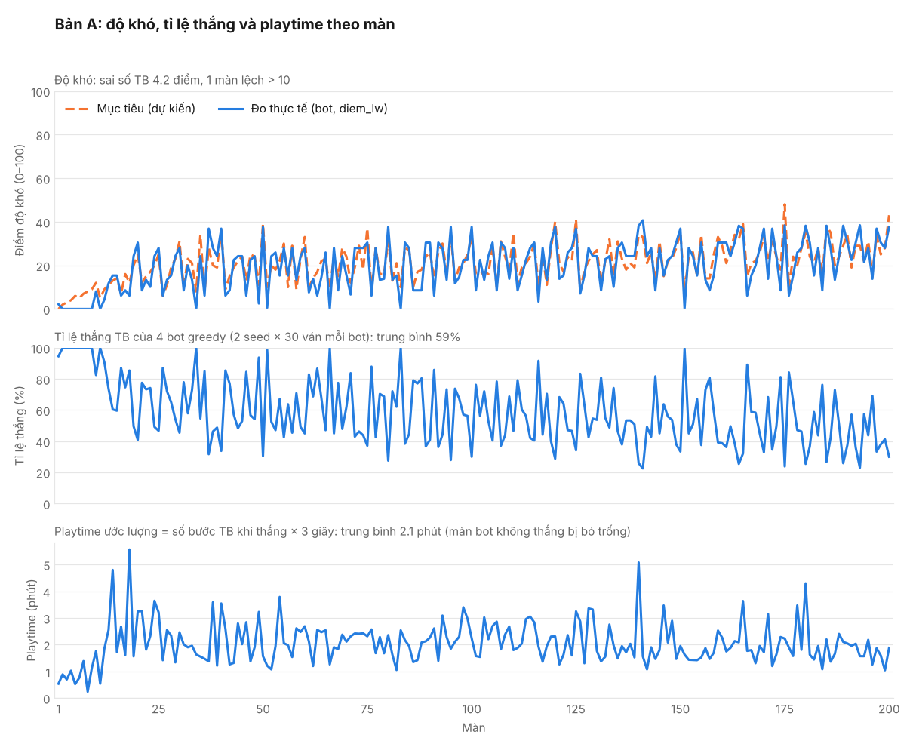
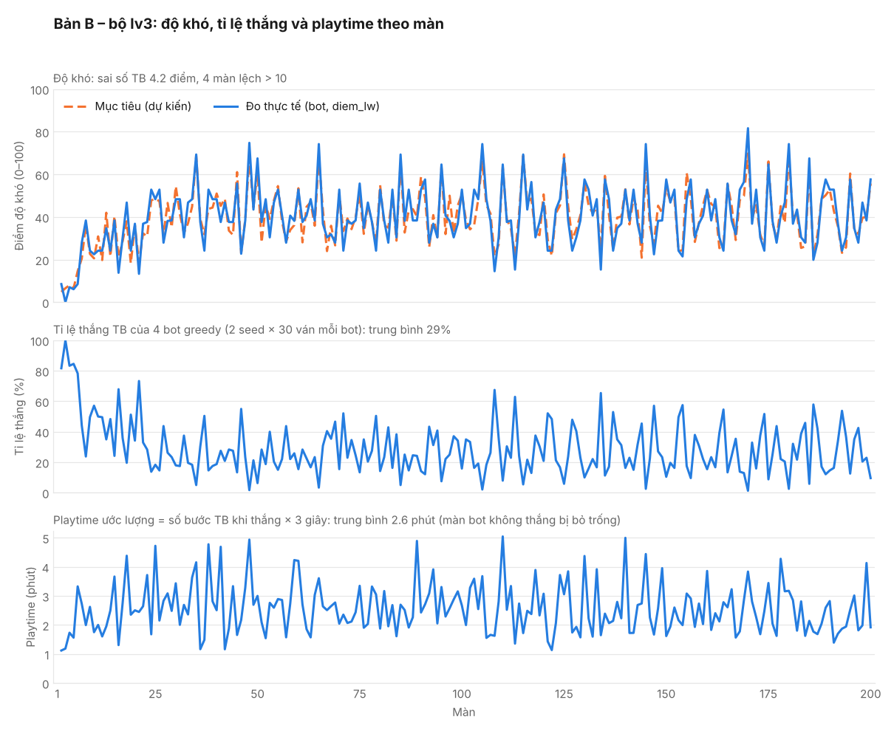
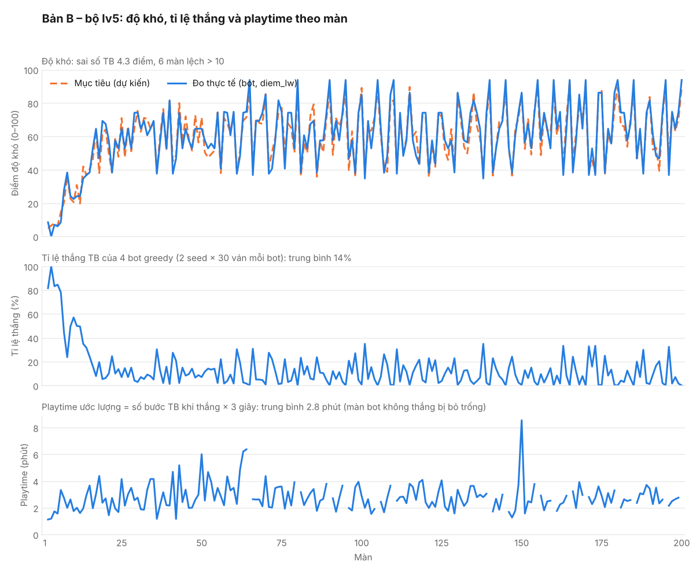

# Báo cáo Sweet Rope: bản A và bản B (28/11/2026)

Báo cáo chung duy nhất cho toàn bộ level đã sinh. Bản A: 200 màn, một bộ cho mọi người chơi, mục tiêu theo đường độ khó riêng. Bản B: 5 bộ (`default`, `lv2`–`lv5`) × 199 màn (màn 1 dùng level hướng dẫn), mục tiêu bằng `summaryScore` của Sort Streak cùng màn cùng bộ; các bộ có cùng điểm ở cùng màn dùng chung một level (680 level).

**Cách đo:** điểm "thực tế" là điểm bot (`tools/score.py`, cột `diem_lw`), sai số khoảng ±9 mỗi level; màn trên 70 điểm bị chấm thấp khoảng 18.

## 0. Tóm tắt

- Tất cả level đúng sức chứa của Sort Streak cùng màn cùng bộ (bản A theo bộ `default`), ≤ 14 cốc, ≤ 7 dây, giải được (solver Godot hoặc bot thắng).
- Đã sửa các màn lệch > 10 điểm: 230 mục (30 màn A, 200 nhóm B); thay 223; sai số TB của nhóm này 16.0 → 3.7; còn 16 mục lệch > 10.
- Trùng lặp với 21 325 level có sẵn trong project: 0 level giống > 80% (giống nhất 0.732).
- Luật LevelDesigner (`validateLevel`, bản port C#): 1195 level, 0 lỗi, 0 cảnh báo.
- Gói Unity `sweetrope.levelpack/1`: `levels/package/SweetRope_A.zip`, `levels/package/SweetRope_B.zip`.

## 1. Độ khó dự kiến (mục tiêu) và thực tế (đo bằng bot, `diem_lw`)

| Bộ | Số màn | Mục tiêu TB | Đo TB | Lệch TB (có dấu) | Sai số TB | ≤ 5 | 5–10 | > 10 |
|---|---|---|---|---|---|---|---|---|
| A | 200 | 21.2 | 20.1 | -1.1 | 4.2 | 127 | 72 | 1 |
| default | 199 | 21.1 | 20.4 | -0.7 | 4.3 | 121 | 74 | 4 |
| lv2 | 199 | 26.7 | 25.9 | -0.8 | 4.1 | 125 | 72 | 2 |
| lv3 | 199 | 39.9 | 40.5 | +0.6 | 4.2 | 127 | 68 | 4 |
| lv4 | 199 | 51.2 | 51.8 | +0.7 | 4.2 | 125 | 69 | 5 |
| lv5 | 199 | 59.6 | 60.6 | +1.0 | 4.3 | 125 | 68 | 6 |

Theo chặng 25 màn (mục tiêu → đo):

| Màn | A | default | lv2 | lv3 | lv4 | lv5 |
|---|---|---|---|---|---|---|
| 1–25 | 11.1 → 8.7 | 14.6 → 13.8 | 18.6 → 18.5 | 25.7 → 26.3 | 30.8 → 31.4 | 35.5 → 36.4 |
| 26–50 | 19.9 → 18.5 | 20.6 → 19.8 | 27.9 → 27.3 | 44.2 → 44.9 | 55.3 → 54.8 | 62.6 → 61.2 |
| 51–75 | 20.2 → 18.7 | 21.0 → 21.0 | 27.2 → 26.8 | 40.3 → 41.2 | 51.7 → 52.4 | 61.6 → 63.0 |
| 76–100 | 21.0 → 19.9 | 22.6 → 21.9 | 25.5 → 23.8 | 42.1 → 42.1 | 54.4 → 56.4 | 62.4 → 64.0 |
| 101–125 | 22.3 → 21.8 | 22.2 → 22.9 | 29.4 → 29.4 | 41.9 → 42.6 | 52.4 → 52.8 | 61.0 → 61.6 |
| 126–150 | 23.0 → 23.7 | 21.3 → 19.7 | 27.5 → 26.8 | 41.5 → 41.1 | 54.4 → 55.2 | 62.5 → 64.4 |
| 151–175 | 25.4 → 23.4 | 22.0 → 21.1 | 28.5 → 26.6 | 42.7 → 43.2 | 54.4 → 54.8 | 65.9 → 66.4 |
| 176–200 | 26.4 → 26.2 | 24.6 → 23.1 | 28.5 → 27.3 | 40.3 → 41.9 | 55.0 → 56.1 | 64.6 → 67.2 |

## 2. Bot: tỉ lệ thắng và số bước khi thắng (playtime)

Bốn cấu hình bot greedy có nhiễu, mỗi cấu hình 2 seed × 30 ván. Playtime ước lượng = số bước TB × 3 giây/bước (giả định).

| Bộ | Thắng eps0.3 | Thắng eps0.45 | Thắng eps0.6 | Thắng softmaxT4 | Thắng TB | Số bước TB | Playtime ước lượng |
|---|---|---|---|---|---|---|---|
| A | 58% | 60% | 60% | 58% | 59% | 41 | 2.1 phút |
| default | 58% | 58% | 58% | 59% | 58% | 41 | 2.1 phút |
| lv2 | 49% | 49% | 49% | 50% | 49% | 44 | 2.2 phút |
| lv3 | 26% | 29% | 30% | 31% | 29% | 51 | 2.6 phút |
| lv4 | 17% | 19% | 22% | 20% | 19% | 52 | 2.6 phút |
| lv5 | 12% | 14% | 15% | 13% | 14% | 54 | 2.7 phút |

Theo chặng (thắng TB % / số bước TB):

| Màn | A | default | lv2 | lv3 | lv4 | lv5 |
|---|---|---|---|---|---|---|
| 1–25 | 81% / 39 | 70% / 39 | 61% / 44 | 49% / 49 | 43% / 45 | 38% / 47 |
| 26–50 | 63% / 41 | 59% / 43 | 46% / 45 | 23% / 55 | 15% / 58 | 10% / 57 |
| 51–75 | 61% / 43 | 58% / 42 | 48% / 47 | 26% / 52 | 18% / 56 | 10% / 67 |
| 76–100 | 59% / 43 | 56% / 45 | 53% / 43 | 26% / 54 | 15% / 58 | 10% / 55 |
| 101–125 | 55% / 44 | 54% / 42 | 42% / 45 | 27% / 51 | 18% / 48 | 12% / 53 |
| 126–150 | 52% / 43 | 59% / 41 | 49% / 41 | 27% / 52 | 16% / 49 | 10% / 50 |
| 151–175 | 53% / 38 | 56% / 40 | 49% / 44 | 26% / 50 | 15% / 50 | 10% / 51 |
| 176–200 | 47% / 38 | 53% / 37 | 46% / 40 | 27% / 47 | 16% / 55 | 9% / 53 |

## 3. Bố cục: level mới so với Sort Streak cùng màn, cùng bộ (TB mới / TB Sort Streak, % màn khớp đúng)

| Bộ | Sức chứa | Số dây đầu | Số cốc | Số màu | Hoa ẩn | Dây khóa | Độ dài hàng chờ |
|---|---|---|---|---|---|---|---|
| A | 5.0 / 5.0 (100%) | 6.4 / 6.4 (99%) | 11.1 / 11.1 (87%) | 8.8 / 8.8 (99%) | 1.8 / 1.9 (80%) | 0.2 / 0.5 (76%) | 10.1 / 10.1 (87%) |
| default | 5.0 / 5.0 (100%) | 6.4 / 6.4 (99%) | 11.0 / 11.1 (88%) | 8.8 / 8.8 (100%) | 1.9 / 1.9 (60%) | 0.2 / 0.5 (78%) | 10.0 / 10.1 (88%) |
| lv2 | 5.0 / 5.0 (100%) | 6.4 / 6.4 (99%) | 11.1 / 11.1 (89%) | 8.8 / 8.8 (100%) | 2.1 / 2.0 (66%) | 0.2 / 0.5 (76%) | 10.1 / 10.1 (89%) |
| lv3 | 5.0 / 5.0 (100%) | 6.4 / 6.4 (99%) | 11.2 / 11.3 (91%) | 8.9 / 8.9 (100%) | 2.6 / 2.6 (58%) | 0.2 / 0.5 (76%) | 10.2 / 10.3 (91%) |
| lv4 | 5.0 / 5.0 (100%) | 6.4 / 6.4 (99%) | 11.3 / 11.3 (91%) | 8.9 / 8.9 (100%) | 2.7 / 2.6 (55%) | 0.2 / 0.6 (74%) | 10.3 / 10.3 (91%) |
| lv5 | 5.0 / 5.0 (100%) | 6.4 / 6.4 (99%) | 11.3 / 11.5 (88%) | 8.9 / 8.9 (100%) | 2.7 / 2.7 (58%) | 0.2 / 0.6 (73%) | 10.3 / 10.5 (88%) |

## 4. Bonus

- **A**: 19 màn bonus cố định, 19 đạt luật (có màu chỉ 1 chậu). Ngoài vị trí bonus còn **181 màn** cũng đủ điều kiện bonus.
- **default**: 19 màn bonus cố định, 19 đạt luật (có màu chỉ 1 chậu). Ngoài vị trí bonus còn **180 màn** cũng đủ điều kiện bonus.
- **lv2**: 19 màn bonus cố định, 19 đạt luật (có màu chỉ 1 chậu). Ngoài vị trí bonus còn **180 màn** cũng đủ điều kiện bonus.
- **lv3**: 19 màn bonus cố định, 19 đạt luật (có màu chỉ 1 chậu). Ngoài vị trí bonus còn **180 màn** cũng đủ điều kiện bonus.
- **lv4**: 19 màn bonus cố định, 19 đạt luật (có màu chỉ 1 chậu). Ngoài vị trí bonus còn **180 màn** cũng đủ điều kiện bonus.
- **lv5**: 19 màn bonus cố định, 19 đạt luật (có màu chỉ 1 chậu). Ngoài vị trí bonus còn **180 màn** cũng đủ điều kiện bonus.

Chi tiết màn ngoài vị trí bonus nhưng đủ điều kiện (màu chỉ có 1 chậu): xem cột `mau_1_chau` trong file chi tiết.

## 5. Tag đặc biệt

| Bộ | Hướng dẫn | Hard | Bonus | Challenge | Endless |
|---|---|---|---|---|---|
| A | 1 | 40 | 19 | 19 | 18 |
| default | 0 | 40 | 19 | 19 | 18 |
| lv2 | 0 | 40 | 19 | 19 | 18 |
| lv3 | 0 | 40 | 19 | 19 | 18 |
| lv4 | 0 | 40 | 19 | 19 | 18 |
| lv5 | 0 | 40 | 19 | 19 | 18 |

## 6. Kiểm trùng lặp

So mỗi level mới với mọi level có sẵn: GD_Lazy (branch main), LevelDesigner/Levels (pack, variant, challenge), `assets/builtin`, `assets/game`, bản A cũ. Độ giống = tỉ lệ vị trí (chậu + hoa) trùng nhau sau khi đổi tên màu tối ưu. Level mới không so với nhau.

- Màn 1 bản A (level hướng dẫn giữ nguyên từ bản cũ) không tính, vì chỉ trùng với chính nó; so với Sort Streak giống 0,39.

- Giống > 80%: **0** level. Giống > 70%: 3 level.

| Level | Giống nhất | Level gần nhất |
|---|---|---|
| B/B|10|default+lv2+lv3+lv4+lv5 | 0.732 | GD_Lazy/Level Difficulty/Generated/SR_trial_S1-3/Levels/Variants/ab_10.json#1470 |
| A/level_075 | 0.722 | LevelDesigner/Variants/ab_10.json#6216 |
| B/B|15|lv3+lv4+lv5 | 0.704 | LevelDesigner/Variants/ab_10.json#6216 |
| A/level_020 | 0.667 | LevelDesigner/Variants/ab_10.json#6216 |
| B/B|30|lv2 | 0.667 | GD_Lazy/Level Difficulty/Generated/SR_trial_S1-3/Levels/Variants/ab_10.json#1470 |

## 7. Luật LevelDesigner và sửa cấu trúc

- Kiểm bằng `validateLevel` của LevelDesigner (`levels/sweet_rope_B/work/tools/designer/core.js`): 1195 level, 0 lỗi, 0 cảnh báo.
- Đã sửa: 2 level có 15 cốc (Unity tối đa 14): bản A màn 86 và bản B màn 36 `lv2`, sinh lại; thêm luật ≤ 14 cốc vào bộ kiểm.
- Không giải lại bằng `BoardSolver` của Unity (theo yêu cầu); tính giải được đã chứng minh khi sinh.

## 8. Sửa các màn lệch > 10 điểm

Mỗi màn sinh 32 ứng viên quanh mức `mix` hiệu chỉnh theo sức chứa, chấm nhanh 20 bản (2 bot × 30 ván), chấm đầy đủ 4 bản gần nhất, chỉ thay khi bản mới gần mục tiêu hơn.

| Bản | Số mục | Được thay | Sai số TB trước | Sai số TB sau | Còn > 10 |
|---|---|---|---|---|---|
| A | 30 | 29 | 14.2 | 3.7 | 1 |
| B | 200 | 194 | 16.3 | 3.7 | 15 |

## 8b. Chơi bừa ở màn đầu (bot chọn nước ngẫu nhiên, 120 ván mỗi màn)

Yêu cầu cho bản A: màn 2–5 chơi bừa thắng 100%; màn 6–9 chỉ thua 1–2 lần và thua lúc gần cuối; từ màn 10 giữ nguyên. Bản B chỉ đo để tham khảo (chưa áp yêu cầu).

| Bản | Màn | Nhóm | Thắng khi chơi bừa | % cốc đã xong khi thua |
|---|---|---|---|---|
| A | 2 | A | 100% | – |
| A | 3 | A | 100% | – |
| A | 4 | A | 100% | – |
| A | 5 | A | 100% | – |
| A | 6 | A | 99% | 90% |
| A | 7 | A | 99% | 91% |
| A | 8 | A | 100% | – |
| A | 9 | A | 98% | 92% |
| B | 2 | default+lv2+lv3+lv4+lv5 | 68% | 15% |
| B | 3 | default+lv2+lv3+lv4+lv5 | 100% | – |
| B | 4 | default+lv2+lv3+lv4+lv5 | 68% | 2% |
| B | 5 | default+lv2+lv3+lv4+lv5 | 68% | 46% |
| B | 6 | default | 54% | 0% |
| B | 6 | lv2+lv3+lv4+lv5 | 100% | – |
| B | 7 | default | 100% | – |
| B | 7 | lv2+lv3+lv4+lv5 | 88% | 24% |
| B | 8 | default | 100% | – |
| B | 8 | lv2 | 8% | 0% |
| B | 8 | lv3+lv4+lv5 | 23% | 19% |
| B | 9 | default | 78% | 10% |
| B | 9 | lv2+lv3+lv4+lv5 | 54% | 0% |
| B | 10 | default+lv2+lv3+lv4+lv5 | 52% | 5% |

## 9. Biểu đồ theo màn (không làm trơn)

Mỗi bộ một hình: độ khó mục tiêu (cam, nét đứt) và đo thực tế (xanh); tỉ lệ thắng TB của 4 bot; playtime ước lượng (số bước TB khi thắng × 3 giây).

### Bản A

### Bản B – default

### Bản B – lv2

### Bản B – lv3

### Bản B – lv4

### Bản B – lv5

## 10. Gói Unity

- `SweetRope_A/Levels/pack_001.json` (màn 1–125), `pack_002.json` (126–200); `SweetRope_B/<bộ>/Levels/pack_001.json`, `pack_002.json`.
- `difficultyType` Hard ở màn 5, 10, …; `difficulty` 1–6 suy từ điểm mục tiêu theo ngưỡng của Sort Streak (< 20,5 → 1; < 38 → 2; < 55 → 3; < 70 → 4; < 85 → 5; còn lại 6).
- Màn 1 bản B là chỗ giữ (màn 1 bản A); dev thay bằng level hướng dẫn. `pack_002` chỉ tới màn 200: khi nhập giữ màn 201–250 cũ.
- Bonus, Challenge, Endless không ghi vào file level (theo luật đã chốt); Challenge và Endless hiện là level thường.

## Phụ lục: file số liệu

- Chi tiết từng màn: `bao_cao_AB_chi_tiet.csv`; bonus tiềm năng: `bao_cao_AB_bonus_tiem_nang.csv`; chơi bừa: `choi_bua_man_2-10.csv`; trùng lặp: `kiem_trung_lap.csv`; sửa màn lệch: `sua_man_lech.csv` (cùng thư mục `levels/sweet_rope_B/reports/`).
