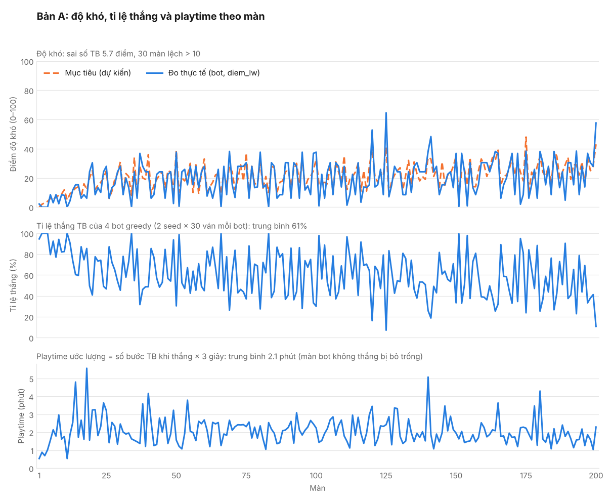
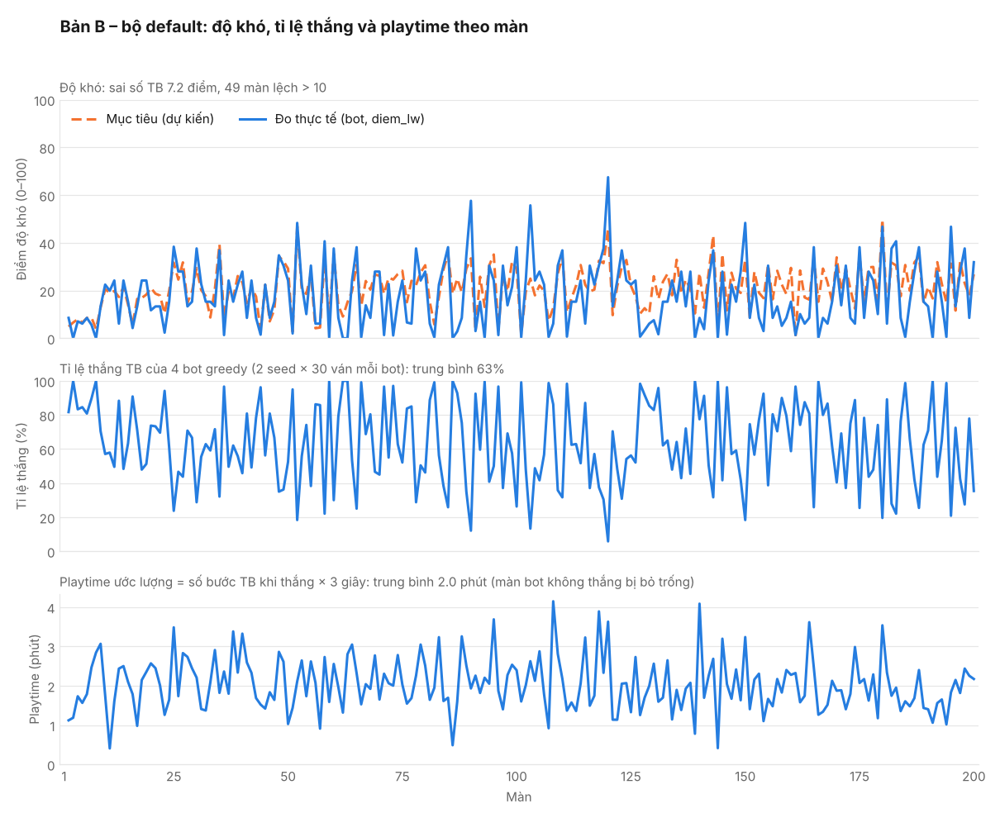
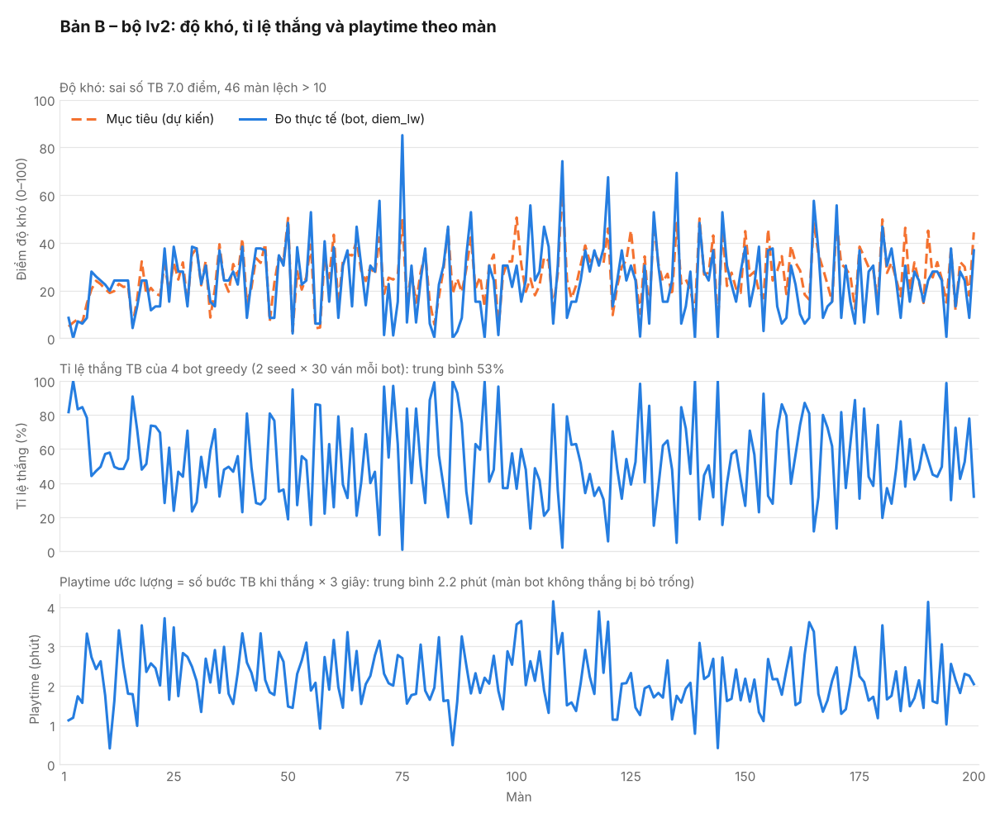
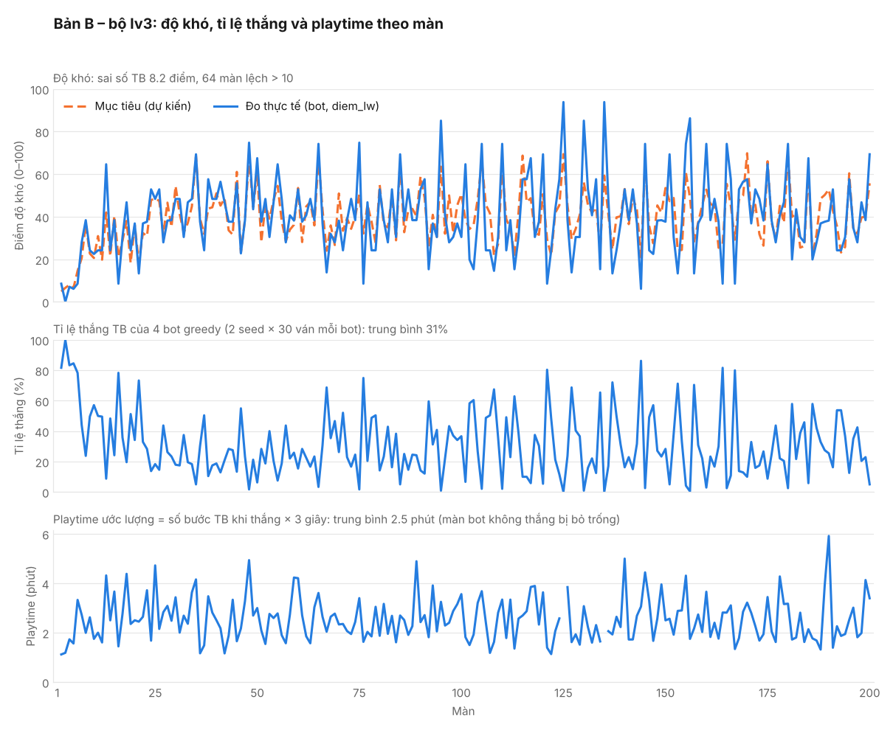
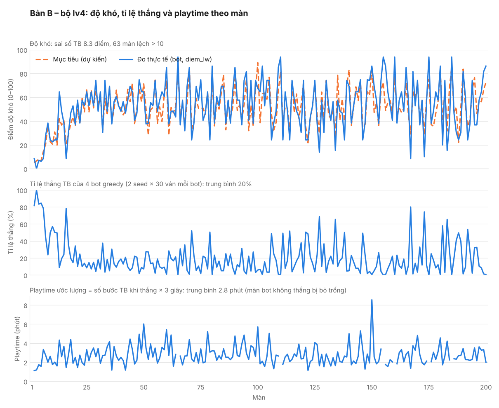
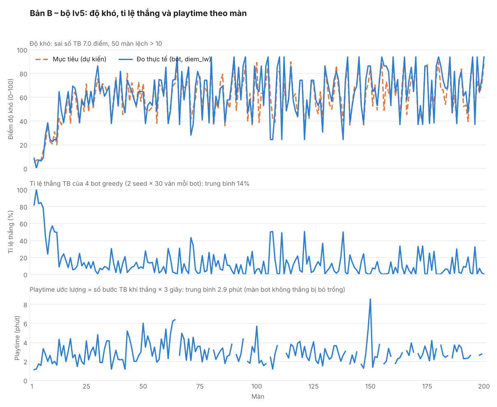

## 1. Độ khó dự kiến (mục tiêu) và thực tế (đo bằng bot, `diem_lw`)

| Bộ | Số màn | Mục tiêu TB | Đo TB | Lệch TB (có dấu) | Sai số TB | ≤ 5 | 5–10 | > 10 |
|---|---|---|---|---|---|---|---|---|
| A | 200 | 21.2 | 19.3 | -1.8 | 5.7 | 107 | 63 | 30 |
| default | 199 | 21.1 | 18.1 | -3.1 | 7.2 | 86 | 64 | 49 |
| lv2 | 199 | 26.7 | 24.3 | -2.3 | 7.0 | 92 | 61 | 46 |
| lv3 | 199 | 39.9 | 40.3 | +0.4 | 8.2 | 81 | 54 | 64 |
| lv4 | 199 | 51.2 | 52.7 | +1.6 | 8.3 | 79 | 57 | 63 |
| lv5 | 199 | 59.6 | 62.0 | +2.3 | 7.0 | 89 | 60 | 50 |

Theo chặng 25 màn (mục tiêu → đo):

| Màn | A | default | lv2 | lv3 | lv4 | lv5 |
|---|---|---|---|---|---|---|
| 1–25 | 11.1 → 9.9 | 14.6 → 13.4 | 18.6 → 18.5 | 25.7 → 27.3 | 30.8 → 32.9 | 35.5 → 38.1 |
| 26–50 | 19.9 → 18.0 | 20.6 → 19.8 | 27.9 → 27.1 | 44.2 → 45.8 | 55.3 → 56.9 | 62.6 → 63.1 |
| 51–75 | 20.2 → 19.3 | 21.0 → 16.7 | 27.2 → 26.7 | 40.3 → 41.9 | 51.7 → 55.7 | 61.6 → 62.8 |
| 76–100 | 21.0 → 19.5 | 22.6 → 19.3 | 25.5 → 20.4 | 42.1 → 39.5 | 54.4 → 57.6 | 62.4 → 64.3 |
| 101–125 | 22.3 → 19.6 | 22.2 → 24.0 | 29.4 → 30.9 | 41.9 → 41.4 | 52.4 → 54.0 | 61.0 → 61.6 |
| 126–150 | 23.0 → 22.2 | 21.3 → 16.0 | 27.5 → 25.6 | 41.5 → 40.1 | 54.4 → 51.7 | 62.5 → 64.3 |
| 151–175 | 25.4 → 22.0 | 22.0 → 13.8 | 28.5 → 21.7 | 42.7 → 46.3 | 54.4 → 59.8 | 65.9 → 70.5 |
| 176–200 | 26.4 → 24.0 | 24.6 → 21.2 | 28.5 → 23.6 | 40.3 → 39.4 | 55.0 → 52.4 | 64.6 → 69.8 |

## 2. Bot: tỉ lệ thắng và số bước khi thắng (playtime)

Bốn cấu hình bot greedy có nhiễu, mỗi cấu hình 2 seed × 30 ván. Playtime ước lượng = số bước TB × 3 giây/bước (giả định).

| Bộ | Thắng eps0.3 | Thắng eps0.45 | Thắng eps0.6 | Thắng softmaxT4 | Thắng TB | Số bước TB | Playtime ước lượng |
|---|---|---|---|---|---|---|---|
| A | 60% | 61% | 61% | 60% | 61% | 41 | 2.1 phút |
| default | 65% | 64% | 62% | 63% | 63% | 41 | 2.0 phút |
| lv2 | 54% | 53% | 52% | 52% | 53% | 43 | 2.2 phút |
| lv3 | 30% | 31% | 32% | 31% | 31% | 51 | 2.5 phút |
| lv4 | 18% | 20% | 22% | 20% | 20% | 53 | 2.7 phút |
| lv5 | 13% | 14% | 15% | 13% | 14% | 56 | 2.8 phút |

Theo chặng (thắng TB % / số bước TB):

| Màn | A | default | lv2 | lv3 | lv4 | lv5 |
|---|---|---|---|---|---|---|
| 1–25 | 78% / 44 | 71% / 39 | 61% / 44 | 49% / 51 | 42% / 47 | 36% / 49 |
| 26–50 | 64% / 41 | 59% / 43 | 46% / 46 | 22% / 52 | 13% / 58 | 9% / 57 |
| 51–75 | 60% / 43 | 67% / 42 | 52% / 46 | 26% / 51 | 16% / 57 | 12% / 73 |
| 76–100 | 60% / 42 | 62% / 43 | 59% / 43 | 30% / 51 | 14% / 62 | 10% / 57 |
| 101–125 | 62% / 43 | 54% / 43 | 43% / 47 | 32% / 49 | 19% / 50 | 15% / 54 |
| 126–150 | 55% / 44 | 67% / 41 | 52% / 37 | 33% / 51 | 20% / 51 | 11% / 50 |
| 151–175 | 56% / 38 | 70% / 39 | 58% / 42 | 26% / 51 | 16% / 49 | 8% / 52 |
| 176–200 | 52% / 37 | 57% / 37 | 52% / 41 | 31% / 50 | 22% / 54 | 8% / 54 |

## 3. Bố cục: level mới so với Sort Streak cùng màn, cùng bộ (TB mới / TB Sort Streak, % màn khớp đúng)

| Bộ | Sức chứa | Số dây đầu | Số cốc | Số màu | Hoa ẩn | Dây khóa | Độ dài hàng chờ |
|---|---|---|---|---|---|---|---|
| A | 5.0 / 5.0 (100%) | 6.4 / 6.4 (100%) | 11.1 / 11.1 (85%) | 8.8 / 8.8 (99%) | 1.9 / 1.9 (80%) | 0.2 / 0.5 (77%) | 10.1 / 10.1 (85%) |
| default | 5.0 / 5.0 (100%) | 6.4 / 6.4 (99%) | 11.0 / 11.1 (88%) | 8.8 / 8.8 (100%) | 1.9 / 1.9 (61%) | 0.2 / 0.5 (79%) | 10.0 / 10.1 (88%) |
| lv2 | 5.0 / 5.0 (100%) | 6.4 / 6.4 (99%) | 11.1 / 11.1 (87%) | 8.8 / 8.8 (100%) | 2.1 / 2.0 (63%) | 0.2 / 0.5 (78%) | 10.1 / 10.1 (87%) |
| lv3 | 5.0 / 5.0 (100%) | 6.4 / 6.4 (99%) | 11.2 / 11.3 (90%) | 8.9 / 8.9 (100%) | 2.6 / 2.6 (56%) | 0.2 / 0.5 (77%) | 10.2 / 10.3 (90%) |
| lv4 | 5.0 / 5.0 (100%) | 6.4 / 6.4 (99%) | 11.3 / 11.3 (90%) | 8.9 / 8.9 (100%) | 2.7 / 2.6 (55%) | 0.2 / 0.6 (75%) | 10.3 / 10.3 (90%) |
| lv5 | 5.0 / 5.0 (100%) | 6.4 / 6.4 (99%) | 11.3 / 11.5 (87%) | 8.9 / 8.9 (100%) | 2.7 / 2.7 (59%) | 0.2 / 0.6 (73%) | 10.3 / 10.5 (87%) |

## 4. Bonus

- **A**: 19 màn bonus cố định, 19 đạt luật (có màu chỉ 1 chậu). Ngoài vị trí bonus còn **181 màn** cũng đủ điều kiện bonus.
- **default**: 19 màn bonus cố định, 19 đạt luật (có màu chỉ 1 chậu). Ngoài vị trí bonus còn **180 màn** cũng đủ điều kiện bonus.
- **lv2**: 19 màn bonus cố định, 19 đạt luật (có màu chỉ 1 chậu). Ngoài vị trí bonus còn **180 màn** cũng đủ điều kiện bonus.
- **lv3**: 19 màn bonus cố định, 19 đạt luật (có màu chỉ 1 chậu). Ngoài vị trí bonus còn **180 màn** cũng đủ điều kiện bonus.
- **lv4**: 19 màn bonus cố định, 19 đạt luật (có màu chỉ 1 chậu). Ngoài vị trí bonus còn **180 màn** cũng đủ điều kiện bonus.
- **lv5**: 19 màn bonus cố định, 19 đạt luật (có màu chỉ 1 chậu). Ngoài vị trí bonus còn **180 màn** cũng đủ điều kiện bonus.

Chi tiết màn ngoài vị trí bonus nhưng đủ điều kiện (màu chỉ có 1 chậu): xem cột `mau_1_chau` trong file chi tiết.

## 5. Tag đặc biệt

| Bộ | Hướng dẫn | Hard | Bonus | Challenge | Endless |
|---|---|---|---|---|---|
| A | 1 | 40 | 19 | 19 | 18 |
| default | 0 | 40 | 19 | 19 | 18 |
| lv2 | 0 | 40 | 19 | 19 | 18 |
| lv3 | 0 | 40 | 19 | 19 | 18 |
| lv4 | 0 | 40 | 19 | 19 | 18 |
| lv5 | 0 | 40 | 19 | 19 | 18 |

## 6. Biểu đồ theo màn (không làm trơn)

Mỗi bộ một hình 3 phần: độ khó mục tiêu (đứt, cam) và đo thực tế (liền, xanh); tỉ lệ thắng TB của 4 bot; playtime ước lượng (số bước TB khi thắng × 3 giây). Số liệu từng màn: `2026-11-28_bao_cao_tong_hop_AB_chi_tiet.csv`.

### Bản A

### Bản B – default

### Bản B – lv2

### Bản B – lv3

### Bản B – lv4

### Bản B – lv5

